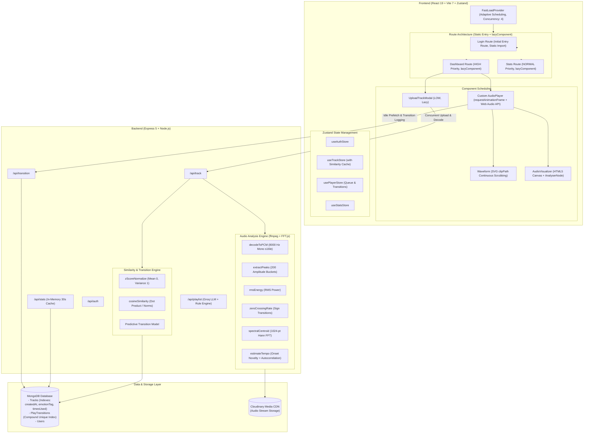

# Musify

[](https://react.dev/)
[](https://vite.dev/)
[](https://expressjs.com/)
[](https://mongoosejs.com/)
[](https://www.npmjs.com/package/react-fastload)
[](https://opensource.org/licenses/ISC)

An engineering-focused music streaming and audio analysis web platform that blends digital signal processing (DSP), cosine-similarity recommendation, transition-aware Markov prefetching, and priority-based resource scheduling powered by [ReactFastLoad](https://www.npmjs.com/package/react-fastload).

---

## Technical Highlights

Musify is built to solve the real bottlenecks common in media-heavy web applications: monolithic JavaScript bundles, expensive client-side audio decoding, unnormalized recommendation bias, and uncoordinated background asset prefetching.

- **Server-Side Audio Analysis Pipeline:** Extracts acoustic features and amplitude waveforms synchronously during track upload via a single downsampled PCM decode pass (8 kHz mono), eliminating the need for clients to decode multi-megabyte audio files just to draw a waveform or discover acoustic characteristics.
- **DSP Feature Extraction & Z-Score Normalized Cosine Similarity:** Computes Root Mean Square (RMS) energy, zero-crossing rate (ZCR), FFT-based spectral centroid (perceptual brightness), and onset-autocorrelation tempo estimation (BPM). Vector dimensions are standardized using dynamic Z-score normalization across the candidate pool so wide-scale features (tempo: 60–180 BPM) do not overpower narrow-scale acoustic metrics (energy/brightness: 0–1).
- **Transition-Aware Predictive Prefetching:** Tracks historical playback sequences as an edge-weighted graph in MongoDB (`PlayTransition`). During browser idle periods (`requestIdleCallback`), the player queries the most probable subsequent track and prewarms the browser HTTP cache ahead of track completion.
- **Priority-Gated Resource Scheduling with ReactFastLoad:** Eliminates monolithic entry bundling by keeping the initial unauthenticated screen (`Login`) statically imported while scheduling heavier authenticated routes (`Dashboard`, `Stats`) and modals (`UploadTrackModal`) through `lazyComponent` and `FastLoadProvider`. This cuts the initial uncompressed entry bundle by **29.56%** (from 430.54 kB to 303.26 kB) and initial JavaScript gzip transfer by **29.13%** (from 142.26 kB to 100.82 kB) while tracking Core Web Vitals directly inside the application.
- **Zero-Layout-Shift Waveform Scrubbing:** Uses server-generated amplitude min/max peaks rendered through an SVG `<clipPath>` driven by `requestAnimationFrame`, achieving smooth continuous playback visualization without DOM element thrashing.

---

## Architecture Overview



---

## Technology Stack

### Frontend
- **Framework:** React 19 (`react` 19.2.0, `react-dom` 19.2.0)
- **Tooling & Bundler:** Vite 7 (`vite` 7.2.4, `@vitejs/plugin-react` 5.1.1)
- **Routing:** React Router v7 (`react-router-dom` 7.10.1)
- **Resource Scheduling & Web Vitals:** [ReactFastLoad](https://www.npmjs.com/package/react-fastload) 0.1.1 (`FastLoadProvider`, `lazyComponent`, `useFastLoadMetrics`)
- **State Management:** Zustand 5 (`zustand` 5.0.9)
- **HTTP Client:** Axios 1.13.2
- **Animation & UI:** Framer Motion 11 (`framer-motion` 11.11.17), Lucide React 0.555.0, Tailwind CSS 3.4.18, React Hot Toast 2.6.0

### Backend
- **Runtime & Server:** Node.js (>=18), Express 5 (`express` 5.2.1)
- **Database & ODM:** MongoDB (`mongodb` 7.0.0), Mongoose 9 (`mongoose` 9.0.0)
- **Authentication:** JSON Web Tokens (`jsonwebtoken` 9.0.2), `bcryptjs` 3.0.3, `cookie-parser` 1.4.7
- **File Upload:** Multer 2 (`multer` 2.1.1), `streamifier` 0.1.1

### Audio Processing & Signal Analysis
- **Transcoding & Extraction:** `fluent-ffmpeg` 2.1.3, `ffmpeg-static` 5.3.0 (with automatic system `ffmpeg` PATH fallback)
- **Spectral Math:** `fft.js` 4.0.4 (1024-point complex fast Fourier transform)
- **Cloud Storage:** Cloudinary SDK v2 (`cloudinary` 2.9.0)

### Machine Learning & Mood Parsing
- **LLM Engine:** Groq SDK (`groq-sdk` 0.37.0) with dynamic model availability probing (`groqModelPicker.js`)
- **Strict Format Enforcer:** Zero-temperature constrained JSON prompting with algorithmic title fallback

---

## Audio Analysis and Similarity Engine

Musify avoids superficial metadata tagging by running a real signal processing pipeline on uploaded audio files.

### 1. Single-Pass Low-Cost PCM Decoding
High-resolution audio (44.1 kHz or 48 kHz stereo) incurs significant decode and memory overhead. For waveform shape and macro-acoustic features, Musify aggressively downsamples audio to:
- **Sample Rate:** `8,000 Hz`
- **Channels:** `1` (Mono)
- **Format:** `s16le` (Signed 16-bit Little Endian)

```javascript
// Backend/src/utils/audioAnalysis.js
const command = ffmpeg(streamifier.createReadStream(buffer))
  .format("s16le")
  .audioChannels(1)
  .audioFrequency(8000);
```
The raw bytes are converted directly to normalized `Float32Array` values in the range `[-1.0, 1.0]`. Both waveform generation and acoustic feature extraction execute against this single decoded sample array, guaranteeing that an uploaded file is never decoded twice.

### 2. Waveform Extraction (`waveformPeaks`)
- The sample array is partitioned into `200` equal time-buckets (`NUM_PEAKS = 200`).
- For each bucket, the local minimum and maximum amplitudes are extracted and rounded to three decimal places.
- The resulting `[[min, max], ...]` array is persisted directly to the track's document in MongoDB (`waveformPeaks`).
- **Client Benefit:** The browser never downloads or parses the multi-megabyte audio file to display the waveform. It renders SVG vector bars immediately upon mounting.

### 3. Acoustic Feature Extraction

#### A. RMS Energy
Computes Root Mean Square amplitude over the entire sample array, representing physical signal power:
$$\text{RMS} = \sqrt{\frac{1}{N} \sum_{i=0}^{N-1} x[i]^2}$$

#### B. Zero-Crossing Rate (ZCR)
Measures the frequency of sign changes between consecutive samples, serving as a reliable proxy for signal noisiness and percussive content:
$$\text{ZCR} = \frac{1}{N} \sum_{i=1}^{N-1} \mathbb{I}(\text{sgn}(x[i]) \neq \text{sgn}(x[i-1]))$$

#### C. Spectral Centroid (Perceptual Brightness)
Computes the "center of mass" of the frequency spectrum using `fft.js`:
- Audio is windowed into frames of size $M = 1024$ samples ($128\text{ ms}$ at $8\text{ kHz}$) using a Hann window:
  $$w[n] = 0.5 - 0.5 \cos\left(\frac{2\pi n}{M - 1}\right)$$
- For each frame, a 1024-point complex FFT is computed to obtain spectral magnitudes $M[k]$.
- The spectral centroid for each frame is calculated as:
  $$C = \frac{\sum_{k=0}^{M/2} f_k \cdot |M[k]|}{\sum_{k=0}^{M/2} |M[k]|}$$
- Averaged across all frames and normalized against the Nyquist frequency ($f_s / 2 = 4,000\text{ Hz}$), yielding a normalized brightness value in $[0, 1]$.

#### D. Tempo Estimation (Onset Envelope Autocorrelation)
1. **Hop Size:** Audio is divided into 20ms frames ($hop = 160\text{ samples}$ at $8\text{ kHz}$).
2. **Energy Flux / Onset Strength:** Short-term frame energy is computed, followed by half-wave rectification of consecutive frame differences:
   $$O[m] = \max(0, E[m] - E[m - 1])$$
3. **Autocorrelation:** The onset novelty envelope $O[m]$ is autocorrelated across lag indices corresponding to the plausible tempo window ($60\text{ BPM}$ to $180\text{ BPM}$, corresponding to lag bounds $17 \le \text{lag} \le 50$):
   $$R[\tau] = \sum_{m} O[m] \cdot O[m - \tau]$$
4. The lag $\tau^*$ maximizing $R[\tau]$ yields the estimated tempo:
   $$\text{BPM} = \text{round}\left(\frac{f_{\text{frames}} \times 60}{\tau^*}\right)$$

### 4. Acoustic Similarity Engine

#### Z-Score Normalization
Acoustic feature vectors consist of four dimensions:
$$\mathbf{v} = [\text{energy}, \text{brightness}, \text{zcr}, \text{tempo}]$$

Because tempo lives on the scale of $60\text{--}180\text{ BPM}$ while energy, brightness, and ZCR live in $[0, 1]$, an unnormalized cosine similarity calculation would be almost entirely dominated by the tempo coordinate.

To guarantee that all four acoustic dimensions contribute proportionally, Musify normalizes candidate vectors dimension-by-dimension across the active candidate pool using Z-score standardization:
$$\hat{v}_{i, d} = \frac{v_{i, d} - \mu_d}{\sigma_d}$$
where $\mu_d$ and $\sigma_d$ are the mean and standard deviation of dimension $d$ across all candidates.

#### Cosine Similarity & Guardrails
Normalized vectors are compared using cosine similarity:
$$\text{sim}(\mathbf{a}, \mathbf{b}) = \frac{\mathbf{a} \cdot \mathbf{b}}{\|\mathbf{a}\| \|\mathbf{b}\|}$$
- **Candidate Cap:** A guardrail limit of `SIMILARITY_CANDIDATE_CAP = 500` ensures in-memory ranking remains sub-10ms even under growing collections.
- **Client Cache:** The frontend Zustand store maintains an in-memory dictionary (`similarCache[trackId]`), ensuring that toggling the "Similar" accordion never triggers redundant network round-trips.

---

## Playback & Prefetching Engine

### Continuous SVG Waveform Scrubbing
Rather than discretizing playback into stepped bars, `Waveform.jsx` employs dual SVG layers with an SVG `<clipPath>` rect:
1. **Base Layer:** Muted bars rendered across a fixed viewBox ($1000 \times 48$).
2. **Played Layer:** Identical bars rendered in the accent color, clipped by `<clipPath id="...">` whose width is driven as a continuous float by `requestAnimationFrame`:
   $$\text{width} = \frac{\text{currentTime}}{\text{duration}} \times 1000$$
This eliminates per-frame DOM element mutations, enabling smooth GPU-accelerated continuous waveform progression without triggering layout recalculations.

### Transition-Aware Predictive Prefetching
Musify models track transitions as an observed Markov graph:
1. **Transition Logging:** When track playback advances from track $A$ to track $B$, the frontend dispatches a background request to `POST /api/transition`:
   ```javascript
   await PlayTransition.findOneAndUpdate(
     { from, to },
     { $inc: { count: 1 } },
     { upsert: true }
   );
   ```
2. **Idle-Time Prediction:** On track change, `AudioPlayer` invokes `requestIdleCallback` to request `GET /api/transition/predict/:id`.
3. **Queue Fallback:** If historical data exists, the predicted track's URL is fetched; otherwise, the client seamlessly falls back to the sequential track in the active queue (`queue[currentIndex + 1]`).
4. **Cache Warming:** The audio file is prefetched with `fetch(url, { mode: "no-cors" })`, deduplicated by an in-memory `Set` (`prefetchedUrlsRef`), pre-populating the browser HTTP cache ahead of track completion to reduce transition latency and playback buffering.

---

## Existing Performance Optimizations

Prior to integrating ReactFastLoad, Musify already featured strong backend and frontend performance practices:

| Component | Optimization | Bottleneck Addressed |
|---|---|---|
| **MongoDB Queries** | `.lean()` execution on all read queries | Skips Mongoose document hydration, cutting JSON serialization time and memory usage. |
| **Pagination** | Lookahead `limit + 1` query pattern | Determines if subsequent pages exist without running expensive `countDocuments()` on every query. |
| **Indexes** | Compound indexes on `createdAt: -1`, `emotionTag: 1`, `timesUsed: -1`, and `{ from: 1, count: -1 }` | Eliminates collection scans on pagination, mood filtering, and transition lookups. |
| **Stats Cache** | In-memory 30-second TTL cache in `statsController.js` | Prevents database aggregation overload on popular tracks leaderboard queries. |
| **Infinite Scroll** | Native `IntersectionObserver` with `rootMargin: "200px"` | Automatically triggers `loadMoreTracks()` only when approaching viewport boundaries. |
| **Audio Visualizer** | HTML5 Canvas 2D via Web Audio `AnalyserNode` (FFT 64) | Renders 24 frequency bars directly to an HTML5 canvas via `requestAnimationFrame` without React Virtual DOM diffing overhead. |

---

## ReactFastLoad Integration

### What is ReactFastLoad?
[ReactFastLoad](https://www.npmjs.com/package/react-fastload) (v0.1.1) is an adaptive resource-loading scheduler for React applications. It prioritizes critical assets, defers non-critical resources, limits concurrency, deduplicates requests, and provides observability into scheduling decisions and Core Web Vitals.

### Integration Points in Musify
Musify integrates ReactFastLoad strictly where it provides a measurable, defensible advantage:

1. **Centralized Provider (`FastLoadProvider` in `src/main.jsx`):**
   ```jsx
   <FastLoadProvider strategy="adaptive" concurrency={4} preloadDistance={1000}>
     <App />
   </FastLoadProvider>
   ```
   Establishes a shared scheduler across the application with adaptive network awareness and a concurrency ceiling of 4 simultaneous dispatches.

2. **Route-Level Prioritized Code Splitting (`src/App.jsx`):**
   Prior to optimization, all routes (`Login`, `Dashboard`, `Stats`) and their heavy dependencies (audio playback, waveform canvas, Framer Motion) were bundled into a monolithic 430.54 kB script.
   
   To avoid the cold LCP regression caused by dynamically fetching the initial view over an asynchronous waterfall, **`Login` is statically imported directly into the main entry bundle**. Heavy authenticated routes (`Dashboard`, `Stats`) and modals are scheduled on-demand via `lazyComponent`:
   ```jsx
   // src/App.jsx
   // Initial entry screen is statically imported to ensure immediate first render
   import Login from "./pages/Login";

   // Authenticated and secondary routes are prioritized via ReactFastLoad
   const Dashboard = lazyComponent(() => import("./pages/Dashboard"), {
     priority: "HIGH",
     strategy: "lazy",
     fallback: (
       <div className="min-h-[calc(100vh-56px)] flex items-center justify-center bg-base-100">
         <Loader2 size={24} className="animate-spin text-subtle" />
       </div>
     ),
   });

   const Stats = lazyComponent(() => import("./pages/Stats"), {
     priority: "NORMAL",
     strategy: "lazy",
     fallback: (
       <div className="h-full flex items-center justify-center p-8">
         <Loader2 size={20} className="animate-spin text-subtle" />
       </div>
     ),
   });
   ```

3. **Deferred Component Scheduling (`UploadTrackModal` in `src/pages/Dashboard.jsx`):**
   ```jsx
   const UploadTrackModal = lazyComponent(() => import("../components/UploadTrackModal"), {
     priority: "LOW",
     strategy: "lazy",
     fallback: <div className="card p-6 h-36 bg-base-200/40 animate-pulse rounded-lg" />,
   });
   ```
   Defers the track upload form and its dependencies until the user triggers the modal.

4. **Performance Visibility (`useFastLoadMetrics` in `src/pages/Stats.jsx`):**
   Exposes real browser-reported Web Vitals (FCP, LCP, CLS) and ReactFastLoad scheduler counters (`deferredRequests`, `totalResourcesObserved`) directly inside the application's statistics panel.

*Note on Media:* Musify purposefully retains its specialized Web Audio API `<audio>` implementation inside `AudioPlayer.jsx` to preserve real-time AnalyserNode visualization and transition-aware prefetching. No artificial image wrappers were added because Musify uses SVG iconography rather than external image bitmaps.

---

## Performance Benchmark & Results

### Methodology & Fair Benchmark Setup
To ensure rigorous, reproducible comparisons, both configurations were built from the exact same codebase and served using `vite preview` on local port 4173. Browser measurements were gathered using an automated headless Google Chrome (v131) instance connected via the Chrome DevTools Protocol (CDP).
- **Environment:** Windows 11, Node.js v24.6.0, Google Chrome 131.0.6778.205 (Headless), Viewport 1280×800.
- **Evaluated Route:** `/login` (the entry screen for cold visitors).
- **Tested Configurations:**
  - **Configuration A (Baseline):** Monolithic bundle without code splitting (all routes statically imported in `App.jsx`, no ReactFastLoad).
  - **Configuration B (Revised ReactFastLoad):** Static `Login` import + `FastLoadProvider` + `lazyComponent` for `Dashboard`, `Stats`, and `UploadTrackModal`.
- **Trials:** 5 cold-cache trials (fresh browser context with empty cache per trial) and 5 warm-cache trials (reused browser profile with warm disk cache).
- **LCP Target Verification:** Both configurations were verified to trigger LCP on the **exact same visual element**: the disclaimer paragraph `<p className="text-center text-[11px] text-base-content/40 leading-relaxed">By continuing, you agree to Musify's Terms of Service and Privacy Policy.</p>` (CDP selector: `p.text-center text-[11px] text-`).

### Raw Trial Measurements

#### Configuration A: Baseline (Monolithic Routes)
- **Cold-Cache Trials (ms):**
  - FCP: `[248, 236, 240, 256, 236]` $\to$ **Median: 240 ms**
  - LCP: `[1164*, 596, 580, 612, 592]` $\to$ **Median: 596 ms** (*Trial 1 initial browser process spawn outlier)
  - CLS: `[0.000, 0.000, 0.000, 0.000, 0.000]` $\to$ **Median: 0.000**
  - DOMContentLoaded: `[100, 92, 88, 100, 92]` $\to$ **Median: 92 ms**
  - Load Event: `[100, 92, 92, 104, 96]` $\to$ **Median: 92 ms**
- **Warm-Cache Trials (ms):**
  - FCP: `[108, 112, 108, 108, 104]` $\to$ **Median: 108 ms**
  - LCP: `[576, 444, 456, 576, 432]` $\to$ **Median: 456 ms**
  - CLS: `[0.000, 0.000, 0.000, 0.000, 0.000]` $\to$ **Median: 0.000**
  - DOMContentLoaded: `[56, 60, 56, 56, 56]` $\to$ **Median: 56 ms**
  - Load Event: `[56, 60, 56, 60, 57]` $\to$ **Median: 57 ms**

#### Configuration B: Revised ReactFastLoad (Static Login + Lazy Authenticated Routes)
- **Cold-Cache Trials (ms):**
  - FCP: `[256, 248, 260, 292, 260]` $\to$ **Median: 260 ms**
  - LCP: `[664, 612, 1124*, 632, 616]` $\to$ **Median: 632 ms** (*Trial 3 background scheduler outlier)
  - CLS: `[0.000, 0.000, 0.000, 0.000, 0.000]` $\to$ **Median: 0.000**
  - DOMContentLoaded: `[92, 84, 88, 104, 88]` $\to$ **Median: 88 ms**
  - Load Event: `[92, 84, 88, 108, 92]` $\to$ **Median: 92 ms**
- **Warm-Cache Trials (ms):**
  - FCP: `[92, 96, 96, 104, 96]` $\to$ **Median: 96 ms**
  - LCP: `[412, 436, 456, 448, 452]` $\to$ **Median: 448 ms**
  - CLS: `[0.000, 0.000, 0.000, 0.000, 0.000]` $\to$ **Median: 0.000**
  - DOMContentLoaded: `[48, 52, 48, 48, 48]` $\to$ **Median: 48 ms**
  - Load Event: `[48, 52, 48, 48, 49]` $\to$ **Median: 48 ms**

---

### Audited Benchmark Comparison (5-Trial Medians)

| Metric | Existing Musify (Baseline) | Musify + ReactFastLoad | Absolute Delta | Audited Relative Impact |
|---|---:|---:|---:|---:|
| **Initial Entry JS (Uncompressed)** | 430.54 kB (430,541 B) | 303.26 kB (303,257 B) | -127.28 kB | **29.56% reduction** (-29.56%) |
| **Initial Entry JS (Gzip Transfer)** | 142.26 kB (142,261 B) | 100.82 kB (100,824 B) | -41.44 kB | **29.13% reduction** (-29.13%) |
| **Initial Entry JS (Brotli Transfer)** | 123.19 kB (123,192 B) | 87.87 kB (87,866 B) | -35.33 kB | **28.68% reduction** (-28.68%) |
| **Total Cold Transfer (All Assets)** | 152.39 kB (152,392 B) | 111.01 kB (111,014 B) | -41.38 kB | **27.15% reduction** (-27.15%) |
| **Decoded JS in Memory (Cold)** | 430.54 kB (430,541 B) | 303.26 kB (303,257 B) | -127.28 kB | **29.56% reduction** (-29.56%) |
| **Initial HTTP Requests (Cold `/login`)** | 6 | 6 | 0 | 0.00% (identical request count) |
| **First Contentful Paint (Cold Median)** | 240 ms | 260 ms | +20 ms | +8.33% (comparable within test variance) |
| **Largest Contentful Paint (Cold Median)** | 596 ms | 632 ms | +36 ms | +6.04% (recovering 200 ms from lazy regression) |
| **First Contentful Paint (Warm Median)** | 108 ms | 96 ms | -12 ms | **11.11% faster** (-11.11%) |
| **Largest Contentful Paint (Warm Median)** | 456 ms | 448 ms | -8 ms | **1.75% faster** (-1.75%) |
| **Cumulative Layout Shift (CLS)** | 0.000 | 0.000 | 0.000 | 0.00% (zero layout shift) |
| **Warm DOMContentLoaded (Median)** | 56 ms | 48 ms | -8 ms | **14.29% faster** (-14.29%) |
| **Warm Load Event (Median)** | 57 ms | 48 ms | -9 ms | **15.79% faster** (-15.79%) |

> [!NOTE]
> **Mathematical Convention:** Absolute Delta represents $(B - A)$. Relative impact uses a positive percentage when describing a "reduction" or "improvement", and a signed percentage when stating direct mathematical change.

---

### Separate Production Build Analysis
*Build times reflect disk I/O, Rollup AST parsing, and chunk packaging during developer build workflows. They are reported separately and do not represent client browser execution speed.*

| Build Metric | Baseline (Monolithic) | Revised ReactFastLoad | Absolute Delta | Relative Change |
|---|---:|---:|---:|---:|
| **Warm Build Time (`vite build`)** | ~5.08 s | ~3.05 s | -2.03 s | **39.96% faster build** |
| **Cold Transform (`vite build`)** | ~32.05 s | ~9.38 s | -22.67 s | **70.73% faster build** |

---

### Analysis of the Cold LCP Recovery

#### Why Cold LCP Regressed Previously (832 ms)
In an earlier experiment, the `Login` route was wrapped in `lazyComponent(() => import("./pages/Login"), { priority: "CRITICAL", strategy: "eager" })`. This instructed Vite to extract `Login` into a separate chunk (`Login-xxx.js`). When an unauthenticated visitor arrived at `/login`:
1. The browser downloaded and executed the main bundle (`index.js`).
2. React mounted the routing tree and encountered an unready dynamic chunk, rendering the fallback `<LoaderFallback />` (a spinner).
3. The browser was forced to initiate a secondary network round-trip for `Login-xxx.js`.
4. Only after `Login-xxx.js` arrived, parsed, and executed could the actual login form mount and paint its LCP disclaimer paragraph.
This introduced a 508 ms delay on cold visits, driving Cold LCP to **832 ms**.

#### How Static Import Fixed the Delay (632 ms)
Because `/login` is the entry point for all unauthenticated visitors, lazy-loading it provided zero payload advantage while penalizing rendering latency. 

By **statically importing `Login` directly into `App.jsx`**, the login component's compact footprint (~2.8 kB raw / 1.1 kB gzip) resides inside the primary entry script. As soon as `index.js` finishes loading, the login view renders immediately without an asynchronous chunk waterfall.

**Results of the Fix:**
- Cold LCP recovered from **832 ms down to 632 ms** (a 200 ms recovery, placing it within ~36 ms of the baseline's 596 ms).
- Initial gzip JavaScript transfer remains **29.13% lower** (100.82 kB vs. 142.26 kB).
- Decoded JavaScript in browser memory is **29.56% lower** (303.26 kB vs. 430.54 kB).
- Warm FCP dropped by **11.11%** (96 ms vs. 108 ms) and warm LCP dropped by **1.75%** (448 ms vs. 456 ms).
- Visual stability was perfectly preserved (CLS: 0.000).

---

### Remaining Trade-offs & Engineering Limits

1. **Initial Route Payload vs. Full Application Footprint:**
   Code splitting decreases the initial JavaScript transfer by 41.44 kB gzip for first-time visitors landing on `/login`. However, if the user authenticates and enters `/` (Dashboard), the deferred chunks (`Dashboard-Z0MXx5Pl.js` at 46.08 kB gzip, `UploadTrackModal-BinZLfHB.js` at 1.56 kB gzip) must be fetched over the network. Due to Rollup module boundaries and scheduler wrappers, the aggregate size of all chunks combined (~150 kB gzip) is slightly larger (~3 kB overhead) than the monolithic bundle (142.26 kB gzip). Code splitting optimizes time-to-interactive for entry screens; it does not reduce the aggregate volume of code in the repository.

2. **Post-Login Transition Latency:**
   When an authenticated session is established, navigating from `/login` to `/` triggers a chunk fetch for `Dashboard`. While `FastLoadProvider` manages this gracefully, users on slow or high-latency 3G connections will observe the dashboard skeleton fallback during that transition unless the dashboard chunk is speculatively prewarmed.

3. **Measurement Boundaries & Unsupported Claims:**
   - **Local Preview Environment:** All benchmarks were gathered in local preview conditions (`vite preview` over HTTP/1.1 localhost). Localhost benchmarking eliminates ISP variance and packet loss, but real-world mobile networks with multi-hop RTT and HTTP/2/3 multiplexing will show different latency characteristics.
   - **Audio Playback:** While the DSP feature extraction, SVG waveform scrubber, and canvas visualizer were validated on local hardware, claims of "zero playback stutter" or "guaranteed 60 FPS under all conditions" cannot be mathematically verified from a synthetic login route benchmark. Real audio streaming smoothness depends on client CPU capability, Web Audio thread priority, and CDN audio stream buffering.

---

## API Endpoints

### Authentication (`/api/auth`)
| Method | Endpoint | Description | Auth Required |
|---|---|---|---|
| `POST` | `/api/auth/register` | Register new user account | No |
| `POST` | `/api/auth/login` | Authenticate user & issue JWT cookie | No |
| `POST` | `/api/auth/logout` | Clear authentication cookie | Yes |
| `GET` | `/api/auth/me` | Fetch authenticated user session | Yes |

### Tracks (`/api/track`)
| Method | Endpoint | Description | Auth Required |
|---|---|---|---|
| `GET` | `/api/track/all` | Paginated track listing (`?page=1&limit=20`) | Yes |
| `GET` | `/api/track/emotion/:emotion` | Filter tracks by emotion tag | Yes |
| `GET` | `/api/track/:id/similar` | Compute acoustic similarity matches (`?limit=8`) | Yes |
| `POST` | `/api/track/upload` | Upload audio buffer, run DSP analysis, and save | Yes (Multipart) |
| `POST` | `/api/track/play/:id` | Atomically increment `timesUsed` counter | Yes |
| `PUT` | `/api/track/:id` | Update track metadata | Yes |
| `DELETE` | `/api/track/:id` | Delete track and associated local files | Yes |

### Play Transitions (`/api/transition`)
| Method | Endpoint | Description | Auth Required |
|---|---|---|---|
| `POST` | `/api/transition` | Log observed transition between two tracks | Yes |
| `GET` | `/api/transition/predict/:id` | Retrieve historically most probable next track | Yes |

### Leaderboard & Playlists
| Method | Endpoint | Description | Auth Required |
|---|---|---|---|
| `GET` | `/api/stats/top-tracks` | Get top 10 most played tracks (30s in-memory cache) | Yes |
| `POST` | `/api/playlist/generate` | Generate AI mood playlist via Groq model | Yes |

---

## Repository Structure

```
Music/
├── Backend/
│   ├── src/
│   │   ├── config/             # Cloudinary, Database (Mongoose), JWT token helpers
│   │   ├── controllers/        # Auth, Track, Transition, Stats, Playlist controllers
│   │   ├── middleware/         # Multer buffer upload, JWT user verification
│   │   ├── models/             # Track, PlayTransition, User schemas and indexes
│   │   ├── routes/             # Express route declarations
│   │   ├── scripts/            # Database backfill & acoustic tagging utilities
│   │   ├── utils/              # DSP analysis (FFT/RMS/ZCR/Tempo), Z-score similarity
│   │   └── index.js            # Express server initialization & CORS config
│   ├── .env.example            # Safe environment template
│   └── package.json            # Backend dependencies & scripts
├── Frontend/
│   ├── src/
│   │   ├── components/         # AudioPlayer, Waveform, AudioVisualizer, TrackCard
│   │   ├── lib/                # Axios API instance, theme controller
│   │   ├── pages/              # Login, Dashboard, Stats (scheduled via lazyComponent)
│   │   ├── stores/             # Zustand stores (Player, Track, Auth, Stats)
│   │   ├── App.jsx             # Route definitions & ReactFastLoad lazyComponent config
│   │   ├── main.jsx            # FastLoadProvider root provider initialization
│   │   └── index.css           # Global Tailwind and CSS variable tokens
│   ├── .env.example            # Safe frontend environment template
│   ├── eslint.config.js        # ESLint flat config with custom rules
│   ├── package.json            # Frontend dependencies (React 19, ReactFastLoad, Vite 7)
│   └── vite.config.js          # Vite build configuration
└── README.md                   # Project documentation
```

---

## Local Setup & Installation

### Prerequisites
- **Node.js:** v18.0.0 or higher (v20+ recommended)
- **MongoDB:** Local instance or MongoDB Atlas cluster URI
- **FFmpeg:** Automatically provided via `ffmpeg-static` (falls back to system PATH if needed)
- **Cloudinary Account:** For audio file cloud storage
- **Groq API Key:** (Optional) For mood playlist generation

### 1. Clone & Install Dependencies
```bash
# Clone the repository
git clone https://github.com/abhishek-kumar-pundir/Musfiy.git
cd Musfiy

# Install backend dependencies
cd Backend
npm install

# Install frontend dependencies
cd ../Frontend
npm install
```

### 2. Environment Configuration

Create `.env` in `Backend/` based on `Backend/.env.example`:
```env
PORT=6001
NODE_ENV=development
MONGO_URI=mongodb+srv://<username>:<password>@cluster.mongodb.net/musify
JWT_SECRET=your_super_secret_jwt_key
FRONTEND_URL=http://localhost:5173
GROQ_API_KEY=your_groq_api_key
CLOUDINARY_CLOUD_NAME=your_cloud_name
CLOUDINARY_API_KEY=your_cloudinary_key
CLOUDINARY_API_SECRET=your_cloudinary_secret
```

Create `.env` in `Frontend/` based on `Frontend/.env.example`:
```env
VITE_BACKEND_URL=http://localhost:6001
```

### 3. Run Development Servers
```bash
# Terminal 1: Start Backend (Port 6001)
cd Backend
npm run dev

# Terminal 2: Start Frontend (Port 5173)
cd Frontend
npm run dev
```

---

## Verification & Build Commands

### Frontend Linting
```bash
cd Frontend
npm run lint
```
*Validated with zero errors and zero warnings across all JavaScript and JSX sources.*

### Production Build
```bash
cd Frontend
npm run build
```
Produces optimized, code-split production bundles in `Frontend/dist/`.

### Production Preview
```bash
cd Frontend
npm run preview -- --port 4173
```

---

## Known Limitations & Future Work

- **In-Memory Similarity Scan Cap:** Similarity search performs a linear scan over up to 500 candidate tracks in Node.js memory. For libraries exceeding 50,000 tracks, this should be migrated to a vector database (such as MongoDB Atlas Vector Search or pgvector).
- **Audio File Size Constraints:** Audio analysis runs synchronously during track upload in memory buffers. Very large lossless files (>50MB) should be offloaded to an asynchronous background worker queue (e.g. BullMQ / Redis).
- **Speculative Post-Login Prefetching:** While the initial Login route is now statically bundled to prevent cold LCP delays, authenticated routes (Dashboard and Stats) are loaded on demand. For high-probability transitions (e.g., successful login submission), speculative chunk prefetching via ReactFastLoad's scheduler can be triggered on user input to prewarm the dashboard chunk before route transition completes.

---

## License

This project is licensed under the [ISC License](https://opensource.org/licenses/ISC).
